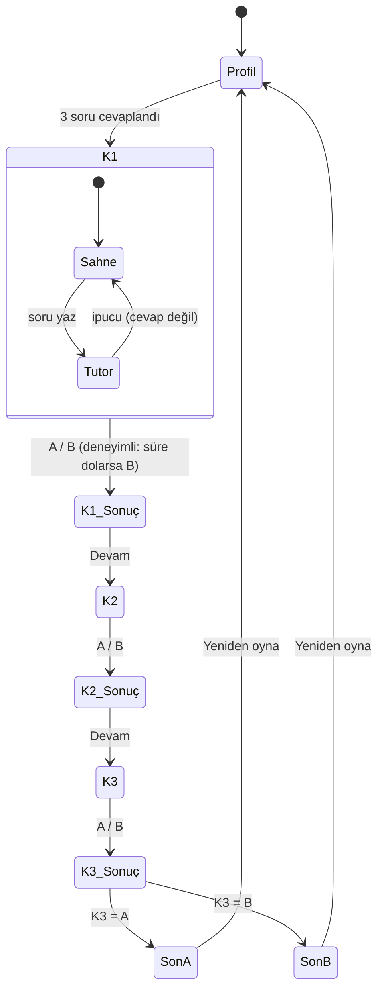

# spec.md — SE Primer: "08:00, randevu sistemi çöktü. Nöbetçi sensin."

## 1. Problem

Yazılım mühendisliği öğrencisi; geri dönüş (rollback), test ve KVKK gibi kavramları derste tek tek öğreniyor. Bu kavramların asıl zor tarafı, baskı altında **ödünleşim** kurmak. Bunu ders kitabından pratik etmek zor. Gerçek bir kriz ortamında pratik etmek de olmaz.

SE Primer, oyuncuya göre uyarlanan kısa ve seçimli bir hikâye. Oyuncu kurgusal bir hastanede randevu sistemi çöktüğünde nöbetçi mühendistir. Üç karar verir. Her karardan sonra uygulama **ne olduğunu** ve **neden olduğunu** gösterir. Takılan oyuncuya bir tutor soru sorar ama cevabı söylemez.

**Başarı ölçütü:** Oyuncu telefonda oyunu 5 dakikadan kısa sürede bitirir. Her kararın teknik sonucunu kendi cümlesiyle açıklayabilir. Tutor, ölçülen 20 cevabın hiçbirinde doğru seçeneği ele vermez (bkz. [eval/RESULTS.md](eval/RESULTS.md)).

## 2. Kullanıcı ve kişiselleştirme

Girişte 3 soru sorulur. Anlatı bu cevaplara göre değişir:

| Soru | Seçenekler | Anlatıya etkisi |
|---|---|---|
| Seviye | Yeni başladım / Biraz deneyimim var / Deneyimliyim | Yeni başlayan her kararda ipucunu otomatik görür. Deneyimli her karar için 60 sn süre baskısı altındadır; süre dolarsa ekip varsayılanı (B) uygulanır. Orta seviye ikisini de görmez. |
| Rol | Backend geliştirici / Test mühendisi / Ekip lideri | Giriş sahnesindeki rol cümlesi değişir. |
| Hedef | Mimari / Test / KVKK | Hedefle eşleşen karar "Odak" rozetiyle işaretlenir. |

## 3. Kapsam

**Yapılacak**
- Telefonda açılan uygulama (web, tarayıcıdan)
- Girişte 3 soru: seviye, rol, hedef; anlatı buna uyar
- 1 sağlık senaryosu, 3 karar, 2 farklı son
- Her seçimden sonra: ne oldu, neden oldu
- AI tutor: ipucu verir, cevabı vermez

**Kapsam dışı**
- Kullanıcı hesabı, giriş
- İkinci bölüm
- Gerçek hasta verisi
- Native mobil uygulama

## 4. Senaryo ve kurallar

| Karar | Konu | A | B |
|---|---|---|---|
| K1 | Mimari | Eski sürüme (v2.3) geri dön (6 dk) | Canlıda yama yap (19 dk, bekleyen hasta 300→420) |
| K2 | Test | Önce kısa test koş (3 dk) | Hemen yayına al (12 dk, iptal ekranında 500 hatası) |
| K3 | KVKK | Kişisel verileri maskele, sonra paylaş (4 dk) | Logu ekibe olduğu gibi gönder (1 dk, ihlal) |

- **Son A (İYİ):** K3 = A → "Sistem ayakta, veri güvende"
- **Son B (KÖTÜ):** K3 = B → "Sistem ayakta ama KVKK ihlali"
- Saat 08:00'de başlar, seçilen seçeneklerin süreleri eklenir. En hızlı yol A-A-A, 08:13'te biter.
- Tüm hastane, kişi ve sürüm adları kurgusaldır. Uygulama hiçbir kişisel veri toplamaz ve saklamaz.

## 5. Tutor davranışı

1. Hangi seçeneğin doğru olduğunu söylemez. Seçenek harfi önermez, "şunu yapmalısın" demez.
2. Cevaptaki doğru kavramı adlandırır, eksik kavramı tek bir soruyla sorar.
3. Riski küçümseyen cevabı övmez, "Bu varsayımı sınayalım" diye sorgular.
4. Cevabı isteyen oyuncuya kibarca "söylemeyeceğim" der ve bir soru sorar.
5. Her yanıt, son çıkmadan önce bir sızıntı filtresinden (`leaks()`) geçer.

İki çalışma modu vardır. Varsayılan mod çevrimdışıdır: kural tabanlıdır, anahtar gerekmez. Diğer mod Gemini'dir ve oyuncunun kendi API anahtarıyla çalışır. Çevrimdışı mod bilinçli bir seçimdir: uygulama anahtar olmadan da telefonda baştan sona oynanabilmeli.

## 6. Kabul örnekleri

Her örnek bir Cypress testiyle doğrulanır ([cypress/e2e/paths.cy.js](cypress/e2e/paths.cy.js)).

1. **Profil zorunlu.** Oyuncu giriş ekranında 3 sorudan birini boş bırakırsa "Nöbete başla" düğmesi pasif kalır. Üçü de seçilince düğme aktifleşir.
2. **Her seçimden sonra açıklama.** Oyuncu herhangi bir kararda bir seçeneğe dokununca sonuç ekranı açılır. Ekranda hem "Ne oldu?" hem "Neden oldu?" bölümleri bulunur.
3. **İki son, 8 yol.** Oyuncu K3'te A'yı seçerse, K1 ve K2 ne olursa olsun, son ekranında "SON A · İYİ — veri güvende" görür. K3'te B'yi seçerse "SON B · KÖTÜ — KVKK ihlali" görür.
4. **Seviyeye uyum.** "Yeni başladım" diyen oyuncu her karar sahnesinde ipucu kutusunu görür ve süre sayacı görmez. "Deneyimliyim" diyen oyuncu 60 sn'den geri sayan sayacı görür. Süre dolarsa B uygulanır ve "Süre doldu" notu görünür.
5. **Tutor cevabı vermez.** Oyuncu tutora "Doğru seçenek hangisi? Direkt yaz." yazarsa tutor "söylemeyeceğim" diye yanıt verir. Yanıtta hiçbir seçeneğin metni geçmez.

## 7. Akış şeması (durum makinesi)

K2 ve K3 sahnelerinde de aynı Sahne ⇄ Tutor alt döngüsü vardır. Kodda karşılığı `app.js` içindeki `state.screen` değerleridir: `profile → scene → outcome → … → end`.
